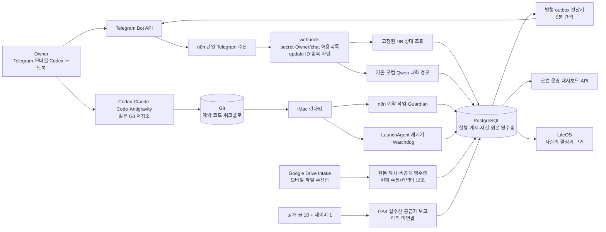

# Atemoya 운영 구조와 검증 기록

기준: 2026-11-01 18:50 KST. 수치는 이 시각의 iMac PostgreSQL·n8n·LaunchAgent 관찰값이며, 다음 조회에서 바뀔 수 있다. 실행 원칙은 [운영 계약](OPERATING_CONTRACT.md), 재조회 명령은 `scripts/preflight.sh`다.

## 사업 범위

앞으로 90일은 **기존 쿠팡 제휴 콘텐츠 한 묶음의 유입 → 클릭 → 공급자 실적 → 현금 → 비용/시간 → 유지·수정·중단 판단**에 집중한다. 사용자가 2026-11-01 확인한 매출은 0원이다. 이것은 공급자 원장에서 확인한 0원과 다르다. 방문·클릭·정산·비용 자료가 없으면 `UNKNOWN`으로 남긴다. 새 콘텐츠 대량 발행과 다른 사업부 실험은 `ops/business-scope-20261101.json`에 따라 일시 중지했다.

## 실행 구조

Git은 버전, PostgreSQL은 실제 실행 상태, 공개 URL은 게시 사실, LifeOS는 인간의 판단 기록이다. IDE의 대화 기록은 운영 상태의 원본이 아니다. Telegram은 사람의 원격 창구이고, 스케줄러나 두 번째 수신기가 아니다. Codex 앱이 꺼져도 iMac의 기존 서비스가 동작한다.

## 실제 적용과 증거

| 구간 | 적용·검증 결과 | 남은 경계 |
| --- | --- | --- |
| Telegram 수신 | 단일 활성 trigger·webhook 각 1개. Bot API webhook 대기 0, 허용되지 않은 local POST HTTP 403. 실사용자 `상태` update 두 건 수신·응답. Owner/chat 허용목록과 update ID 유일 제약을 DB에 적용; 허용·중복·미허용 케이스 트랜잭션 검증. | 최종 채널별 문구는 코드·SQL 검사까지 완료. 사용자 새 입력으로 다시 받은 것은 이전 11/11 문구까지다. |
| 게시·알림 | 직접 작업 10/10 `succeeded`, 사이트 게시 10건과 네이버 게시 1건. 발행 outbox 10건 `sent`, `pending` 0, `failed` 0. 전달기 실행 성공; 재시도는 30분 임대 후 가능하므로 API 성공 직후 장애에서는 재전송될 수 있다. | Telegram API 접수는 실제 읽음 증거가 아니다. 신규 발행은 사업 범위 결정에 따라 대기. |
| 일일 점검 | 오래된 발행량 기준을 제거. `AtemoyaOpsGuardian01` 실행 4675 성공, 일일 판정 `REVIEW`, 게시 `idle`, 계측 `unknown`, provider `rule`, model `none`, Telegram 전송 시각 기록. Watchdog의 로컬 LLM idle 오판을 고쳐 전체 검사 `GOOD`; 오래된 pipeline 사건과 잘못 열린 LLM 사건 종료. | 계측 연결 전 `REVIEW`는 정상적으로 남는다. |
| 범위 축소 | n8n 활성 14→8. Hardware Lab, Preauth Agents, Portfolio Review, Commerce Scout, Daily Trend와 구형 CEO 오후 브리핑의 예약 실행 중지. 브리핑은 미계측 현금을 0원으로 표시하므로 Guardian 한 경로로 교체했다. 배포 스크립트가 범위 결정 파일에 있는 워크플로의 재활성화를 거부하는 시험 통과. 사라진 스크립트를 반복 실행하던 LaunchAgent 4개와 구형 autopilot publisher 비활성화. | 기존 워크플로 export는 이력으로 보존한다. 재개 시 범위 결정 변경과 새 검증이 필요하다. |
| Drive·원본 | [Atemoya Intake](https://drive.google.com/drive/folders/18HKiNfDAY-IeRG0l6TAS5JL2PA-CDITk) 생성. 텍스트 canary 업로드·메타데이터·내용 재확인. Drive 파일 ID·SHA-256 영수증을 한번만 기록. 기존 쿠팡 2026-09-12 XLSX 원본을 해시로 수입하고 `empty_report`로 검사; 재수입은 `existing`, 재무 전기 없음. 현재 intake 2건. | iMac의 Google Drive OAuth/서비스 자격이 없어 자동 폴링은 미구축. 실제 값이 있는 공급자 원본도 없다. |
| 계측 | 사용자 보고 0원 기준일을 Telegram·대시보드에 표시. DB의 클릭, 공급자 batch, journal, 현금, 유입 지표는 각각 0행으로 표기하되 실제 0 실적으로 해석하지 않음. | GA4 숫자 속성 ID·읽기 권한·실수신, 쿠팡 보고 자료와 정산 정의가 필요하다. |
| 도구·문서 | `AGENTS.md`와 중립적 운영 계약, Codex skill, `.agents/skills` 어댑터가 같은 저장소를 가리킴. skill 두 곳 검증 통과. `~/Documents/Atemoya`는 실제 Git 저장소로 향하는 symlink, 옛 설계 문서 2개는 `docs/archive`로 이동·내부 링크 수정. | Codex 앱 저장 프로젝트의 `isGitRepository` 메타데이터는 아직 false; GUI에서 재등록/새로고침 필요. Claude Code 설치만 확인했고 Antigravity 실행 검증은 못 했다. |

비밀값·Telegram actor/chat 식별자·공급자 원본은 Git과 LifeOS 밖에 둔다. 수신 gate와 outbox는 각각 `db/migrations/017_telegram_owner_gate.sql`, `n8n/workflows/exports/AtemoyaAffiliateOutboxNotify01.json`에 정의되어 있다. Drive 영수증은 `db/migrations/018_affiliate_intake_files.sql`과 `tools/record_intake_file.py`다.

## 운영 관찰과 디버깅

1. `scripts/preflight.sh`: n8n·PostgreSQL·Ollama·LaunchAgent, 직접 게시, 알림, 계측 공백, 최근 24시간 오류를 확인한다.
2. `http://127.0.0.1:8765/api/status`: Telegram 수신 마지막 시각, outbox 전달, intake 건수, 매출 보고 기준일과 미계측 지표를 보여준다. 화면은 같은 서버의 `tools/atemoya-dashboard.html`이다.
3. `tools/ops-watchdog.py`: 5분마다 서비스·네트워크·작업 정체를 검사하고 상태 전환만 사건으로 기록한다. 작업이 없는 로컬 LLM은 정상 `idle`이다. 이 watchdog은 현재 개인 투자 API/수집기도 함께 본다. 분리 작업 전까지 투자 복구 경로를 삭제하지 않는다.
4. `AtemoyaOpsGuardian01`: 매일 규칙 기반 보고를 만든다. 발행 0건/7일만으로 장애를 선언하지 않는다. `ops_daily_reviews`에 infra·publication·measurement 상태를 각각 기록한다.
5. Telegram `상태`: 긴 로컬 모델 호출을 기다리지 않고 읽기 전용 PostgreSQL 집계를 답한다. 모호한 상태 변경은 기존 승인 경로의 별도 검증이 필요하며 이 변경으로 전체 자연어 명령 검증을 완료했다고 보지 않는다.

장애 때에는 `요청/업데이트 ID → n8n execution ID → DB receipt·job·outbox event → 공개 URL 또는 공급자 원본 해시` 순서로 좁힌다. 실패 재현 전에 원본과 DB를 백업한다. 이번 작업의 마지막 백업은 `/Users/orange/Atemoya/backups/20261101T093746Z`다. 워크플로 롤백은 그 백업의 export를 다시 적용하고 n8n을 재시작한 뒤 webhook과 실제 요청을 확인한다.

## 인수 상태와 다음 연결

| 검증 | 판정 | 근거/다음 행동 |
| --- | --- | --- |
| 서버·수신·중복·발행 outbox | 통과 | healthz, webhook 1개, 실사용자 왕복, DB receipt, outbox 10건 sent |
| 게시 결과·사업 범위 | 통과 | 직접 job 10건, 공개 기록 11건, parked workflow 6개 비활성, 재활성 방지 |
| 원본 보관·기초 검사 | 부분 통과 | Drive canary·기존 빈 쿠팡 XLSX의 해시·멱등 검사. 실제 실적 행/정산 대사는 미검증 |
| 방문·클릭·확정 수수료·현금·비용 | 미완료 | GA4 실수신과 실제 공급자/비용 근거 연결 필요. 0행은 0원 증거 아님 |
| 원격/도구 전환 | 부분 통과 | Telegram 실사용자 왕복·Git 경로 정리. 모바일 Codex 원격 명령, 노트북, Claude/Antigravity 실제 실행, iMac 밖 heartbeat는 미검증 |

다음 사업 실험은 **기존 LED 콘텐츠 한 묶음**으로 한정한다. GA4의 실수신과 쿠팡 보고서 원본을 같은 기간으로 연결하고, 비용·작업시간 근거를 더한 뒤 KEEP/UPDATE/STOP을 결정한다. 신규 채널·대량 발행·유료 사용은 이 판단 전까지 시작하지 않는다.
