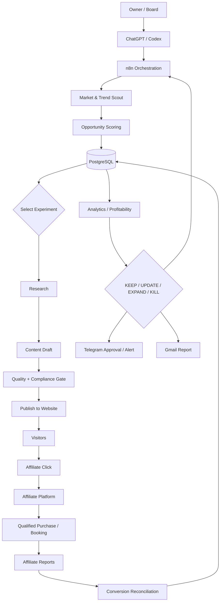
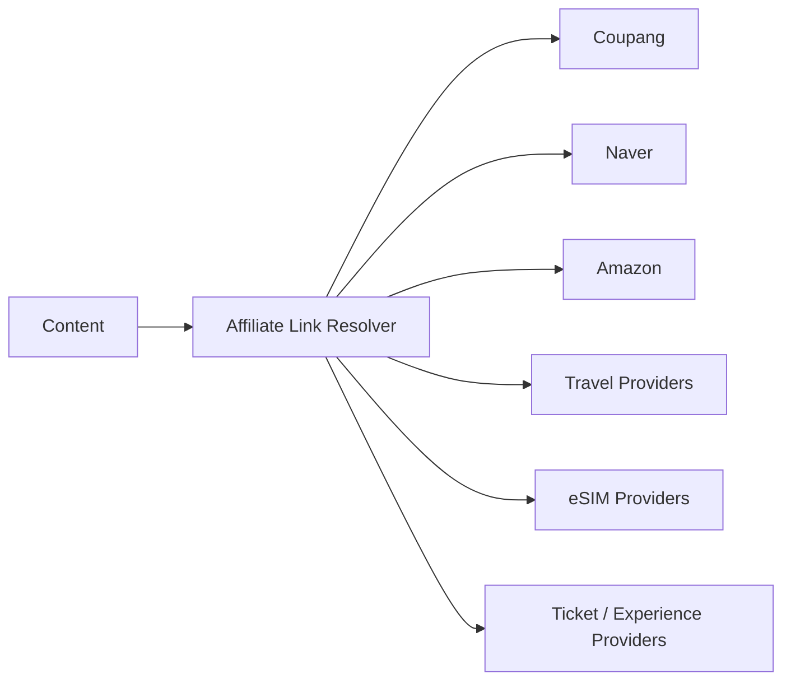
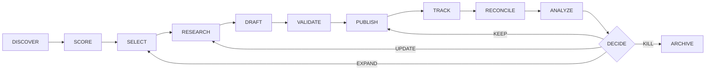

# Atemoya Affiliate Business OS
## End-to-End Architecture, Business Logic, Monetization & Validation Blueprint

> **Purpose**  
> This document is the baseline architecture for Atemoya's affiliate-content business.  
> It is designed so that the whole system can be reviewed, tested, automated, measured, and improved without depending on one specific product category.

---

# 1. Executive Summary

Atemoya is not a generic blog and not an IT-only affiliate site.

The operating model is:

**Discover demand → Select profitable categories → Create high-intent content → Attach compliant affiliate offers → Track clicks and conversions → Measure contribution margin → Expand winners / kill losers**

The user acts as **Owner / Board** and should only:
- Set direction
- Approve material spending
- Approve major market/category expansion
- Approve irreversible or high-risk actions

AI and automation should handle:
- Market discovery
- Category scoring
- Content research
- Drafting
- Compliance checks
- Publishing
- Affiliate link insertion
- Click tracking
- Conversion reconciliation
- Profitability analysis
- KEEP / UPDATE / EXPAND / KILL recommendations
- Daily / weekly / monthly reporting

The primary business model is **affiliate commerce content**.

Initial category candidates:
1. Korea travel for foreigners
2. K-pop
3. K-beauty
4. K-food
5. Korea shopping
6. IT / AI / hardware

These are **not fixed strategic categories**. They are experimental portfolios and must compete on measured unit economics.

---

# 2. Core Business Principle

Atemoya should optimize for:

> **Monthly net cash flow generated with minimal owner involvement.**

Not:
- Pageviews alone
- Number of posts
- Social followers
- Number of AI agents
- Number of workflows
- Gross affiliate revenue

The preferred outcome is:

```text
Low owner effort
+ repeatable traffic
+ purchase intent
+ compliant affiliate monetization
+ measurable attribution
+ low support burden
= scalable cash-flowing digital asset
```

---

# 3. Business Model Summary

## 3.1 Customer Segments

### Primary
- Foreign travelers planning a trip to Korea
- Global K-pop fans
- K-beauty buyers
- K-food buyers
- Korea-shopping-oriented audiences
- Tech / AI hardware buyers

### Secondary
- Expats
- Students visiting Korea
- Digital nomads visiting Korea
- Korean consumers researching technical products

---

## 3.2 Value Proposition

Atemoya should answer commercially useful questions such as:

- What should I buy?
- Which option is better for me?
- What should I prepare before arriving in Korea?
- Which products are actually worth buying in Korea?
- Where should I stay for a K-pop concert?
- What should I bring?
- What is cheaper locally versus online?
- Which product is compatible with my use case?
- What is the best option by budget?

The goal is to reduce user decision friction immediately before a purchase or booking.

---

## 3.3 Revenue Sources

### Physical product affiliate
- Coupang Partners
- Naver Shopping Connect
- Amazon Associates
- Other approved retail affiliate platforms

### Travel affiliate
Provider-agnostic architecture for:
- Hotels
- eSIM
- Airport transport
- Tours
- Tickets
- Experiences
- Rail / transport passes
- Travel accessories

### Future optional monetization
- Display ads
- Sponsored placements with strict disclosure
- Digital products
- Subscription content

The current baseline does **not** depend on free tools.

---

# 4. Important Affiliate Assumption

Atemoya must **not** assume that a click alone generates commission.

Default revenue logic:

```text
Affiliate Link Click
        ↓
Qualified Purchase / Booking / Action
        ↓
Platform Attribution
        ↓
Commission
```

Each affiliate provider has different:
- Attribution windows
- Commission rules
- Approved traffic sources
- Link-format restrictions
- Disclosure rules
- Country availability
- Product eligibility
- Refund / cancellation treatment

Therefore every provider must be represented by its own configurable policy record.

---

# 5. End-to-End Business Architecture



---

# 6. System Responsibilities

## 6.1 GitHub
**Source of Truth**

Store:
- Website source
- Content templates
- n8n workflow exports
- Docker Compose
- DB schema / migrations
- Agent prompts
- Scoring rules
- Ops documentation
- Recovery instructions
- Compliance templates

Never store:
- Passwords
- API tokens
- 2FA secrets
- Private SSH keys
- Raw credentials

---

## 6.2 PostgreSQL
**Operational Memory**

Stores:
- Category candidates
- Opportunities
- Evidence
- Affiliate programs
- Affiliate items
- Content inventory
- Links
- Clicks
- Conversion imports
- Revenue
- Costs
- Experiments
- Executions
- Agent actions
- Approvals

---

## 6.3 n8n
**Execution Engine**

Responsibilities:
- Schedules
- Source ingestion
- Deduplication
- AI calls
- Scoring
- Draft workflows
- Publishing
- Affiliate sync
- Conversion import
- Reporting
- Retry
- Error alerting

---

## 6.4 Telegram
**Immediate Alert / Approval Channel**

Use for:
- High-value opportunities
- Broken workflows
- Sudden revenue drop
- Approval-required spend
- EXPAND / KILL recommendations

Do not use Telegram as the primary data store.

---

## 6.5 Gmail
**Formal Reporting**

Use for:
- Daily digest
- Weekly board report
- Monthly performance report

---

## 6.6 Google Calendar
**Management Cadence**

Use for:
- Weekly review
- Monthly portfolio review
- Quarterly category review

---

## 6.7 Obsidian
**Human-readable Long-Term Knowledge**

Add later.

Use for:
- Strategic decisions
- Lessons learned
- Research notes
- Retrospectives
- Playbooks

PostgreSQL remains the system of record.

---

# 7. Category Discovery Engine

Atemoya must discover categories based on **commercial opportunity**, not personal familiarity.

## 7.1 Inputs

Potential signals:
- Search demand
- Search growth
- Google Trends
- YouTube search / viewing trends
- Reddit discussions
- Product Hunt
- Naver search
- Social chatter
- K-tourism trends
- Travel seasonality
- Affiliate availability
- Average order value
- Commission potential
- Competition
- SERP difficulty
- Content gap
- Commercial intent
- Repeat purchase potential
- Automation suitability

---

## 7.2 Category Score

Suggested 100-point score:

| Factor | Weight |
|---|---:|
| Search / demand growth | 15 |
| Purchase intent | 15 |
| Affiliate availability | 10 |
| Expected commission potential | 10 |
| Average order value | 10 |
| Competition / difficulty | 10 |
| Content scalability | 10 |
| Automation fit | 10 |
| Seasonality resilience | 5 |
| Strategic fit | 5 |

### Interpretation

- **80–100**: High priority experiment
- **65–79**: Test with limited content
- **50–64**: Watchlist
- **<50**: Do not invest yet

---

# 8. Initial Category Portfolio

## 8.1 Korea Travel for Foreigners
Potential monetization:
- Hotels
- eSIM
- Airport transport
- Tours
- Tickets
- Transit
- Luggage
- Travel adapters
- Power banks

Example content:
- First trip to Seoul checklist
- Best areas to stay in Seoul
- Korea eSIM comparison
- Incheon airport to Seoul options
- What to buy before your Korea trip

---

## 8.2 K-pop
Potential monetization:
- Albums
- Light sticks
- Merch
- Concert travel
- Hotels
- Transport
- Fan experiences
- Accessories

Example content:
- What to bring to a K-pop concert in Seoul
- Best areas to stay for Gocheok Sky Dome
- Light stick buying guide
- Korea concert travel checklist

---

## 8.3 K-beauty
Potential monetization:
- Skincare
- Makeup
- Beauty devices
- Bundles
- Travel shopping

Example content:
- Best Korean sunscreen by skin type
- What K-beauty products are worth buying in Korea
- Olive Young alternatives
- Korean skincare starter routine

---

## 8.4 K-food
Potential monetization:
- Snacks
- Ramen
- Sauces
- Cooking kits
- Kitchen accessories

Example content:
- Korean snacks worth buying
- Best ramen for beginners
- Korean pantry starter kit

---

## 8.5 Korea Shopping
Potential monetization:
- Physical products
- Souvenir items
- Travel accessories
- Seasonal items

Example content:
- Best things to buy in Korea
- Korea shopping checklist
- What is cheaper in Korea than abroad

---

## 8.6 IT / AI
Potential monetization:
- Mac
- SSD
- NAS
- GPU
- Mini PC
- Networking gear
- AI hardware

This remains a valid category, but it must compete against other categories on measured profitability.

---

# 9. Affiliate Platform Layer

Use a provider-agnostic design.



Each provider adapter should support:

- Program name
- Market / country
- Affiliate ID
- Link format
- Allowed referrer types
- Commission type
- Commission rate / rule
- Attribution window
- Deep-link support
- API availability
- Report format
- Refund / cancellation logic
- Disclosure requirements
- Active / inactive state

---

# 10. Affiliate Link Management

## 10.1 Core Rules

Do:
- Use provider-issued affiliate links
- Preserve tracking parameters
- Record click events separately
- Show affiliate disclosure
- Validate links periodically
- Track locale / country

Do not:
- Hide or alter links in ways prohibited by provider policy
- Misrepresent price
- Fabricate discounts
- Fabricate reviews
- Auto-click
- Incentivize prohibited clicks
- Use misleading redirects

---

## 10.2 Suggested Flow

```text
Content page
   ↓
User clicks recommended product
   ↓
Atemoya records click event
   ↓
Redirect / open approved affiliate destination
   ↓
Provider records attribution
   ↓
Purchase / booking
   ↓
Provider report
   ↓
Atemoya reconciliation
```

---

# 11. PostgreSQL Data Model

## 11.1 categories

```sql
id
slug
name
market
language
status
score
created_at
updated_at
```

---

## 11.2 opportunities

```sql
id
category_id
title
hypothesis
evidence_score
opportunity_score
purchase_intent_score
competition_score
commission_score
automation_score
status
created_at
```

---

## 11.3 source_evidence

```sql
id
opportunity_id
source_type
source_url
source_title
observed_at
summary
confidence
```

---

## 11.4 affiliate_programs

```sql
id
provider
program_name
country
currency
commission_type
commission_rule
attribution_window
terms_url
active
last_verified_at
```

---

## 11.5 affiliate_items

```sql
id
affiliate_program_id
external_item_id
name
brand
category
destination_url
affiliate_url
currency
price
commission_override
country
active
last_checked_at
```

---

## 11.6 content

```sql
id
category_id
slug
title
language
country
content_type
search_intent
status
published_at
updated_at
canonical_url
```

---

## 11.7 content_affiliate_map

```sql
id
content_id
affiliate_item_id
placement
priority
context
active
```

---

## 11.8 clicks

```sql
id
content_id
affiliate_item_id
affiliate_program_id
clicked_at
session_id
country
device_type
referrer
utm_source
utm_medium
utm_campaign
```

---

## 11.9 conversions

```sql
id
affiliate_program_id
external_conversion_id
affiliate_item_id
conversion_at
order_value
commission_value
currency
status
imported_at
```

---

## 11.10 revenue

```sql
id
source
category_id
content_id
amount
currency
revenue_date
type
```

---

## 11.11 costs

```sql
id
category
amount
currency
cost_date
description
```

---

## 11.12 experiments

```sql
id
category_id
name
hypothesis
start_date
end_date
success_metric
minimum_sample
status
decision
```

---

## 11.13 executions

```sql
id
workflow_name
started_at
ended_at
status
cost
error_message
```

---

## 11.14 agent_actions

```sql
id
agent_name
action_type
entity_type
entity_id
input_reference
output_summary
confidence
model_name
cost
created_at
```

---

## 11.15 approvals

```sql
id
action_type
entity_type
entity_id
requested_at
approved_at
status
approver
```

---

# 12. Core Business Logic



---

# 13. Business Workflow Detail

## 13.1 Discover
Identify:
- Search demand
- Trend growth
- New products
- Travel demand
- Viral topics
- Commercial keywords
- Affiliate availability

Output:
- Opportunity candidate

---

## 13.2 Score
Apply category/opportunity scoring.

Reject:
- No affiliate route
- Low purchase intent
- Excessive competition
- Unsafe / non-compliant monetization
- High support burden

---

## 13.3 Select
Select limited experiments.

Avoid:
- Launching 20 categories at once
- Publishing hundreds of AI posts without validation

---

## 13.4 Research
Collect:
- Search intent
- Competing pages
- User objections
- Product/service details
- Affiliate options
- Price range
- Evidence

---

## 13.5 Draft
Preferred content forms:
- Comparison
- Best X for Y
- Buyer guide
- Checklist
- Itinerary with commercial intent
- What to buy
- What to bring
- Where to stay
- Before-you-go guide
- Budget guide

---

## 13.6 Validate

Checks:
- Factual accuracy
- Search intent alignment
- Affiliate disclosure
- No fake experience
- No fabricated reviews
- No unsupported price claims
- Link validity
- Correct locale
- Correct provider
- Readability
- Original value

---

## 13.7 Publish
Publish only after passing quality gate.

---

## 13.8 Track
Capture:
- Pageviews
- Affiliate clicks
- CTR
- Scroll depth if available
- Country
- Device
- Referrer

---

## 13.9 Reconcile
Import provider reports.

Match:
- clicks
- orders
- bookings
- commission
- returns
- cancellations

---

## 13.10 Decide
Every asset receives one decision:

- KEEP
- UPDATE
- EXPAND
- KILL

---

# 14. n8n Workflow Design

## 14.1 Workflow A — Opportunity Scout

```text
Schedule
→ Source collection
→ Normalize
→ Deduplicate
→ AI summarize
→ Score
→ Store in PostgreSQL
→ High-score Telegram alert
```

---

## 14.2 Workflow B — Category Review

```text
Weekly
→ Load category metrics
→ Compare scores
→ Detect winners/losers
→ Recommend EXPAND/KILL
→ Telegram approval if needed
```

---

## 14.3 Workflow C — Content Research

```text
Selected opportunity
→ Gather evidence
→ Extract user intent
→ Collect product/service options
→ Save research bundle
```

---

## 14.4 Workflow D — Content Draft

```text
Research bundle
→ Generate outline
→ Generate draft
→ Insert affiliate disclosure placeholder
→ Link candidate products/services
```

---

## 14.5 Workflow E — Quality & Compliance Gate

```text
Draft
→ Fact check
→ Disclosure check
→ Link check
→ Duplicate-content check
→ SEO structure check
→ PASS / FAIL
```

---

## 14.6 Workflow F — Affiliate Sync

```text
Daily / scheduled
→ Load affiliate catalog/report/API
→ Update item price/status
→ Mark dead links
→ Alert abnormal changes
```

---

## 14.7 Workflow G — Publish

```text
Approved content
→ Git branch
→ Build
→ Quality gate
→ Deploy
→ Confirm URL
→ Store canonical URL
```

---

## 14.8 Workflow H — Click Ingest

```text
Website click event
→ Validate payload
→ Store clicks
→ Aggregate daily CTR
```

---

## 14.9 Workflow I — Conversion Reconciliation

```text
Import affiliate reports
→ Normalize
→ Match program/item/content
→ Store conversion
→ Calculate commission
→ Update revenue
```

---

## 14.10 Workflow J — Daily Report

```text
Daily
→ Revenue
→ Clicks
→ Conversions
→ Errors
→ New opportunities
→ Telegram summary
```

---

## 14.11 Workflow K — Weekly Board

```text
Weekly
→ Revenue by category
→ Profit by category
→ Top content
→ Low performers
→ New tests
→ KEEP/UPDATE/EXPAND/KILL
→ Gmail report
```

---

# 15. Revenue Model

Basic affiliate revenue equation:

```text
Revenue
=
Traffic
× Affiliate CTR
× Conversion Rate
× Average Order Value
× Commission Rate
```

For booking/service programs:

```text
Revenue
=
Qualified Clicks
× Booking Conversion
× Average Booking Value
× Commission Rate
```

---

# 16. Key KPIs

## Traffic
- Sessions
- Search impressions
- Organic clicks
- Country mix

## Commercial
- Affiliate CTR
- Conversion rate
- Average order value
- Commission per conversion
- Earnings per click (EPC)

## Content economics
- Revenue per article
- Revenue per 1,000 sessions
- Profit per article
- Time to first conversion
- Payback period

## Portfolio
- Revenue by category
- Profit by category
- Owner hours per category
- Automation coverage
- Platform dependency

---

# 17. Primary Decision Metrics

Atemoya should prioritize:

1. **EPC**
2. **Revenue per 1,000 sessions**
3. **Profit per content asset**
4. **30-day revenue growth**
5. **Owner time required**
6. **Support burden**
7. **Platform concentration risk**

---

# 18. Experiment Design

## Initial experiment size

Per category:
- 10–20 high-intent content assets
- 2–4 content formats
- At least 2 monetization placements where possible

Do not publish 100+ articles before validation.

---

## Suggested experiment categories

Phase 1 candidates:
- Korea Travel
- K-pop
- K-beauty
- Korea Shopping
- IT / AI

K-food can follow quickly if signals are strong.

---

# 19. Experiment Success Criteria

A category should show at least some of:

- Search impressions increasing
- Organic clicks growing
- Affiliate CTR above site baseline
- At least one verified conversion
- EPC competitive with portfolio median
- Content production cost reasonable
- Low compliance/support burden

---

# 20. Stopping Rules

Kill or pause when:
- No impressions after enough indexing time
- Impressions but near-zero clicks
- Clicks but persistent zero conversion
- Commission too low
- Provider program unstable
- Content maintenance too expensive
- Compliance risk too high
- Competition makes ranking uneconomic

---

# 21. Review Windows

## 7-day
Use only for:
- Indexing
- Technical issues
- Broken links
- Major engagement problems

Do not kill SEO experiments purely from 7-day revenue.

## 30-day
Evaluate:
- Early traffic
- CTR
- First conversions
- Affiliate program fit

## 90-day
Make portfolio decision:
- KEEP
- UPDATE
- EXPAND
- KILL

---

# 22. 30-Day Decision Logic

### EXPAND candidate
- Traffic growing
- CTR above median
- At least one or more conversions
- EPC encouraging
- Low maintenance

### UPDATE candidate
- Traffic exists
- Low CTR or conversion
- Clear content/offer mismatch

### KILL candidate
- Weak traffic
- Weak commercial intent
- No meaningful path to conversion
- High maintenance

---

# 23. 90-Day Decision Logic

A category becomes a serious portfolio asset if:
- Repeatable traffic exists
- Conversions recur
- Unit economics are positive
- Content can scale
- Affiliate programs are stable
- Owner effort is minimal

---

# 24. Compliance Requirements

Mandatory:

- Clear affiliate disclosure
- Provider-specific policy compliance
- No fabricated reviews
- No fabricated ownership/experience claims
- No misleading pricing
- No fake urgency
- No prohibited redirects
- No automated click generation
- No incentive schemes prohibited by provider
- No mass low-value AI content

---

# 25. Affiliate Disclosure Pattern

Every commercial page should include a visible disclosure equivalent to:

> This page may contain affiliate links. Atemoya may earn a commission when a qualifying purchase or booking is made through those links, at no additional cost to the reader.

Final wording should be adapted to each market/provider requirement.

---

# 26. Price / Availability Policy

Never assume static pricing.

Content should use:
- “Check current price”
- “Price may vary”
- Last-checked timestamps if price is displayed

Automations should periodically:
- Validate destination URLs
- Mark inactive items
- Remove dead offers

---

# 27. Multilingual Strategy

## Phase 1
- English
- Korean

## Phase 2
- Japanese
- Selected Southeast Asian languages

## China
Treat separately due:
- Platform ecosystem
- Search behavior
- Payments
- Regulatory environment
- Affiliate availability

---

# 28. Geographic Strategy

### English site
Priority:
- US
- Canada
- UK
- Australia
- Singapore
- Global K-culture audience

### Korean site
Priority:
- Domestic commerce
- Korean product / tech comparison

### Japan / Southeast Asia
Expand only after measured demand.

---

# 29. Current Atemoya Infrastructure

Already established:
- GitHub repository
- GitHub Pages
- Website
- Content quality automation
- iMac server
- Docker
- n8n
- PostgreSQL
- Tailscale
- Telegram test integration
- Remote Windows access

---

# 30. Current Gaps

Missing or incomplete:

- Affiliate program master table
- Affiliate item catalog
- Link management
- Click tracking
- Conversion import
- Revenue reconciliation
- Category scoring engine
- Experiment framework
- Portfolio decision engine
- Commercial-intent content pipeline
- Affiliate compliance gate
- Provider-specific adapters
- Profitability reporting

---

# 31. Target Production Architecture

```text
                        Owner
                          │
                    ChatGPT/Codex
                          │
                         n8n
          ┌───────────────┼────────────────┐
          │               │                │
      Market Scout   Content Engine   Affiliate Engine
          │               │                │
          └───────────────┼────────────────┘
                          │
                    PostgreSQL
                          │
           ┌──────────────┼──────────────┐
           │              │              │
        Website        Analytics      Reporting
           │              │              │
        Visitors       Clicks         Telegram
           │           Conversions     Gmail
           ▼              │
    Affiliate Platforms───┘
           │
        Revenue
```

---

# 32. Phase Roadmap

## Phase 0 — Baseline
Goal:
- Stabilize current infrastructure
- Freeze architecture
- Ensure Git / DB / n8n recovery

Deliverables:
- Architecture doc
- DB schema
- n8n export structure
- backup/restore guide

---

## Phase 1 — Affiliate Core
Goal:
Build the commercial data layer.

Deliverables:
- affiliate_programs
- affiliate_items
- content_affiliate_map
- clicks
- conversions
- revenue

---

## Phase 2 — Category Experiments
Goal:
Test real demand.

Launch:
- Korea Travel
- K-pop
- K-beauty
- Korea Shopping
- IT/AI

10–20 high-intent content assets per selected experiment.

---

## Phase 3 — Attribution & Revenue
Goal:
Know exactly what makes money.

Deliverables:
- Click tracking
- Report import
- Conversion reconciliation
- Revenue dashboard
- EPC by content/category

---

## Phase 4 — Automation Scale
Goal:
Reduce human operations.

Automate:
- Scout
- Research
- Draft
- QA
- Affiliate sync
- Publish
- Reporting

---

## Phase 5 — Portfolio Optimization
Goal:
Operate like an investment portfolio.

Every category/content asset receives:
- KEEP
- UPDATE
- EXPAND
- KILL

based on real profitability.

---

# 33. Validation Matrix

| Area | Validation | Pass Criterion |
|---|---|---|
| Infrastructure | n8n / DB available | Stable restart and health check |
| Recovery | Restore test | Can recover from backup |
| Git | Reproducibility | Config/docs versioned |
| Content | Quality gate | Required checks pass |
| Affiliate | Link validity | No broken commercial links |
| Compliance | Disclosure | 100% commercial pages disclosed |
| Tracking | Click events | Event stored correctly |
| Attribution | Conversion import | Provider report reconciles |
| Revenue | Commission record | Revenue traceable to provider |
| Category | Commercial evidence | At least one measurable signal |
| Experiment | Review cadence | 30/90-day decision made |
| Automation | Error handling | Failed flows alert/retry |
| Portfolio | Kill discipline | Weak assets are actually stopped |

---

# 34. Technical Validation Checklist

## GitHub
- [ ] Main branch protected as needed
- [ ] Feature-branch workflow
- [ ] Secrets excluded
- [ ] Workflow exports versioned
- [ ] DB schema versioned

## PostgreSQL
- [ ] Schema migrations
- [ ] Primary keys
- [ ] Foreign keys
- [ ] Indexes on time/content/program fields
- [ ] Backups
- [ ] Restore test

## n8n
- [ ] Credentials stored securely
- [ ] Error workflow
- [ ] Retry policy
- [ ] Execution retention
- [ ] Workflow export

## Website
- [ ] SEO metadata
- [ ] Affiliate disclosure
- [ ] Click event capture
- [ ] Locale
- [ ] Canonical URLs

---

# 35. Business Validation Checklist

- [ ] Category has measurable demand
- [ ] Purchase intent exists
- [ ] At least one affiliate route exists
- [ ] Commission economics are acceptable
- [ ] Competition is survivable
- [ ] Content can scale
- [ ] No excessive support burden
- [ ] Provider risk acceptable
- [ ] 30-day test defined
- [ ] 90-day decision defined

---

# 36. Revenue Validation Checklist

- [ ] Clicks recorded
- [ ] Provider clicks reasonably align
- [ ] Conversion reports imported
- [ ] Commission reconciled
- [ ] Refunds/cancellations handled
- [ ] Revenue by content known
- [ ] Revenue by category known
- [ ] EPC known
- [ ] Profit after AI/API/hosting cost known

---

# 37. Portfolio Scoring

Suggested 100-point business score:

| Metric | Weight |
|---|---:|
| Monthly net profit | 25 |
| 6-month stability | 20 |
| Low owner operating time | 20 |
| Low support burden | 15 |
| Low platform dependency | 10 |
| Maintainable without growth | 10 |

High revenue with high manual support is **not** a Cash Cow.

---

# 38. Reporting

## Daily Telegram
- Revenue
- Clicks
- Conversions
- Workflow failures
- New high-score opportunities

## Weekly Email
- Revenue by category
- Top content
- Worst content
- EPC
- New experiments
- EXPAND / KILL candidates

## Monthly Board
- Net profit
- Portfolio mix
- Platform concentration
- Owner hours
- AI/API cost
- Growth recommendations

---

# 39. Risk Management

## Platform concentration
Do not let one affiliate program become an existential dependency.

Track:
- % revenue by platform
- % revenue by category
- % traffic by channel

## Content risk
Avoid:
- Pure AI commodity content
- Unsupported claims
- Thin product roundups
- Fake first-hand reviews

## Operational risk
Mitigate:
- Automated backup
- External monitoring
- Retry
- Fail alerts
- Versioned workflows

---

# 40. Architecture Review Questions

Before building any new feature, ask:

1. Does this improve net cash flow?
2. Does this reduce owner effort?
3. Can it be measured?
4. Can it be automated?
5. Is the data stored?
6. Can it be reproduced from Git?
7. Is there a rollback?
8. Is it compliant?
9. Does it reduce or increase platform dependency?
10. What metric decides whether we keep it?

---

# 41. Immediate Priorities

## Priority 1
Create the affiliate data layer.

- affiliate_programs
- affiliate_items
- content_affiliate_map
- clicks
- conversions
- revenue

## Priority 2
Create category scoring.

Start with:
- Korea Travel
- K-pop
- K-beauty
- Korea Shopping
- IT/AI

## Priority 3
Create 3–5 pilot commercial content pieces per top category.

## Priority 4
Add click tracking and affiliate disclosure.

## Priority 5
Import the first real provider performance report.

## Priority 6
Measure real EPC and revenue.

---

# 42. First Practical Experiment

Recommended first experiment:

## Korea Travel + K-pop cluster

Why:
- International audience
- Travel spending
- Multiple affiliate opportunities
- High-intent content formats
- Product + booking monetization can coexist

Initial content examples:
1. First-time Seoul travel checklist
2. Best Seoul areas for K-pop fans
3. What to bring to a K-pop concert in Korea
4. Korea eSIM guide
5. Incheon Airport to Seoul comparison
6. Best travel power banks for Korea
7. What to buy in Korea
8. K-pop shopping guide in Seoul
9. Where to stay near major concert venues
10. Korea travel adapter guide

Measure:
- Impressions
- Sessions
- Affiliate CTR
- Conversion
- EPC
- Revenue per content asset

---

# 43. Definition of Done

The affiliate business system is **not complete** when:
- Articles are published
- Affiliate links exist
- n8n workflows run

It is complete when:

```text
Opportunity discovered
→ scored
→ content published
→ affiliate link clicked
→ conversion imported
→ commission recorded
→ profitability calculated
→ AI recommends KEEP / UPDATE / EXPAND / KILL
```

and the owner can review the result without manually reconstructing the data.

---

# 44. Final Target State

Atemoya should eventually operate like this:

```text
AI discovers a growing Korea-travel topic
↓
AI scores commercial potential
↓
AI identifies eligible affiliate programs
↓
AI drafts content
↓
Compliance + quality gate
↓
Content publishes
↓
Clicks and conversions are tracked
↓
Commission is reconciled
↓
Profitability is measured
↓
AI recommends EXPAND
↓
Owner approves only major decisions
```

That is the target **Atemoya Affiliate Business OS**.
